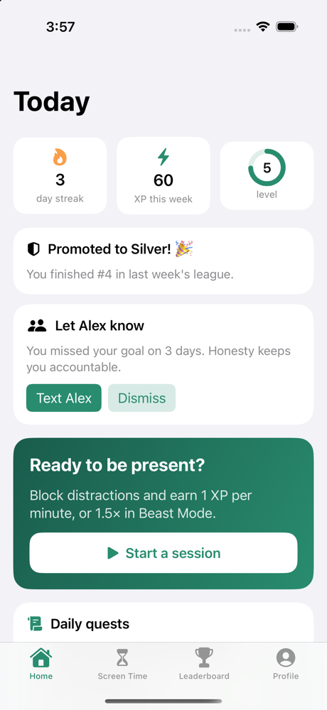
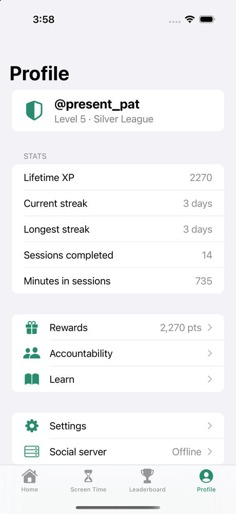
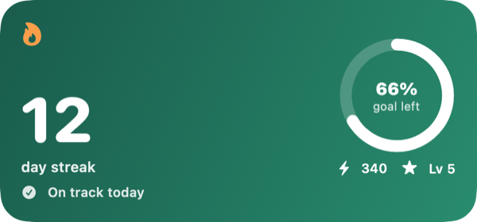

# Unscroll

An open-source alternative to [BePresent](https://www.bepresentapp.com/). Unscroll is a free iPhone app that helps you spend less time on your phone.

<p>
   
</p>

## Features

- **Present Sessions**: block distracting apps now or on a schedule. **Beast Mode** has no way out until the timer ends.
- **Intentions**: daily time or opens limits per app, with an "Is this intentional?" screen before each open.
- **Daily goal and streaks**: stay under your screen-time goal to keep your streak alive.
- **XP, levels and daily quests**.
- **Weekly leagues**: climb from Bronze to Present. Use the offline league, or your own server for real leaderboards.
- **Groups**: invite-only groups with a shared leaderboard and activity feed.
- **Accountability**: text a partner when you slip, or pledge a donation to a cause.
- **Rewards**: spend the points you earn on real-life treats you choose.
- **Doomscroll alerts**, a usage report, tips and short articles.
- **Home and lock screen widgets** showing your streak.

It's built on Apple's Screen Time API. Your usage data stays on your phone.



## Getting started

You need Xcode 16 or later, an iPhone on iOS 17+, a **paid** Apple Developer account (Apple doesn't allow the Screen Time permission on free accounts), and [XcodeGen](https://github.com/yonaskolb/XcodeGen).

```bash
brew install xcodegen
DEVELOPMENT_TEAM=<your team id> xcodegen generate
open Unscroll.xcodeproj
```

Then select your iPhone and press **Run**. If the bundle IDs are taken, change `bundleIdPrefix`, the `PRODUCT_BUNDLE_IDENTIFIER`s and the App Group in `project.yml`, and update `SharedContainer.appGroupID` to match.

App blocking only works on a real device. To browse the UI in the Simulator with sample data, launch with the `-demo` argument.

## Project layout

| Path | What's inside |
|---|---|
| `App/` | SwiftUI app |
| `Extensions/` | Screen Time extensions (monitor, shield, shield action, report) and the widget |
| `Packages/UnscrollKit/` | Core logic: sessions, streaks, XP, quests, leagues, storage |
| `Server/` | Optional zero-dependency Node server for leaderboards and groups ([docs](Server/README.md)) |

## Tests

```bash
cd Packages/UnscrollKit && swift test
cd Server && npm test
```

## Contributing

Issues and pull requests are welcome.

## License

[MIT](LICENSE)
