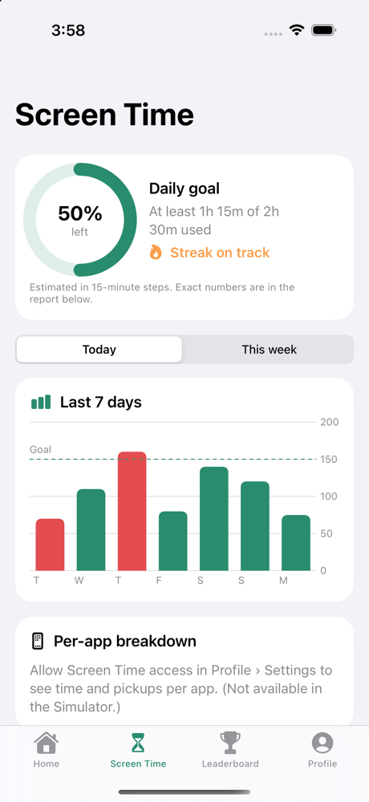
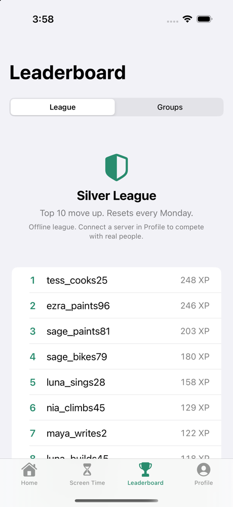

# Unscroll

**A free, open-source screen time app for iPhone.** Block distracting apps, set intentions, build streaks, earn XP, climb weekly leagues and keep each other accountable. It's an open alternative to [BePresent](https://www.bepresentapp.com/), built on Apple's Screen Time API, with no subscription, paywall or tracking.

<p>
   
</p>

## Features

| BePresent feature | Unscroll |
|---|---|
| Screen Time API blocking (individual sessions) | ✅ Present Sessions that block selected apps, or everything except selected apps |
| Scheduled sessions (start/end time, days) | ✅ Recurring schedules enforced by a `DeviceActivityMonitor` extension, even when the app is closed |
| BEAST MODE | ✅ No way out until the timer ends; earns 1.5× XP |
| Intentions (per-app/category time and opens limits) | ✅ Every open goes through an "Is this intentional?" shield; going over costs you the day's credit, but you're never hard-locked |
| Daily goal and streaks | ✅ Goal tracked with `DeviceActivityEvent` thresholds over "All Apps & Categories" |
| XP, levels and daily quests | ✅ 3 deterministic daily quests, XP for sessions, goals, intentions and streaks |
| Weekly leaderboards with tiers (top 10 promote) | ✅ Bronze → Silver → Gold → Platinum → Diamond → Present. Offline simulated league, or real people via the server |
| Groups and group sessions | ✅ Invite-only groups with weekly XP/screen-time boards and a live activity feed (needs the server) |
| Accountability partner | ✅ Drafts an iMessage/SMS when you miss your goal; you choose to send it |
| Monetary stakes | ✅ Honor-system pledge to a cause you choose; no payment data is collected |
| Real-life rewards | ✅ Define your own rewards ("movie night: 500 pts") and redeem XP points. No partner deals |
| Mindless-scrolling alerts | ✅ Hourly "Still scrolling?" notifications from the monitor extension |
| Screen time reports | ✅ `DeviceActivityReport` extension with total time, pickups and per-app list, plus a 7-day goal chart |
| Streak widget (home and lock screen) | ✅ Small and medium home-screen widgets, plus circular, rectangular and inline lock-screen widgets |
| Onboarding quiz, "years of your life" shock and reframe | ✅ Without the paywall |
| Tip of the day and well-being articles | ✅ Focus, sleep, ADHD, mental health, relationships |

## How it works

```
┌────────────── Unscroll.app (SwiftUI) ──────────────┐      App Group container
│ AppModel ── immutable AppState ── StateStore ──────┼──▶ state.json   (app only)
│     │ resync                                       │    config.json  (app → extensions)
│     ▼                                            ◀─┼─── inbox/*.json (extensions → app, one file per event)
│ ScreenTimeService ── ShieldController/Scheduler    │    opens.json   (shield action only)
└────────────────────────────────────────────────────┘    limits.json  (monitor only)
   DeviceActivityMonitor ext   ── schedules, usage milestones, goal and intention thresholds
   ShieldConfiguration ext     ── "Is this intentional?" / Beast Mode shield screens
   ShieldAction ext            ── open with intention, break session, relock after N minutes
   DeviceActivityReport ext    ── private per-app usage UI
```

* **`Packages/UnscrollKit`**: platform-independent core: models, a pure reducer (`AppState.applying/endingSession/finalizingDays…`), XP/streak/quest/league engines and file persistence. 74 tests with about 95% line coverage.
* **`UnscrollScreenTime`** (same package, iOS only): FamilyControls/ManagedSettings/DeviceActivity glue shared by the app and the extensions.
* **`App/`**: the SwiftUI app. **`Extensions/`**: the four Screen Time extensions, each a thin shim over the package.
* **`Server/`**: an optional, zero-dependency Node server for real leaderboards and groups (46 tests). See [Server/README.md](Server/README.md).

Apple never gives the host app raw usage data. Unscroll estimates today's usage from threshold events in 15-minute steps. The exact per-app numbers appear only inside the sandboxed report extension.

## Build and run

Requirements: Xcode 16+ (tested with Xcode 27.1), iOS 17+, [XcodeGen](https://github.com/yonaskolb/XcodeGen) (`brew install xcodegen`).

```bash
xcodegen generate              # creates Unscroll.xcodeproj from project.yml
open Unscroll.xcodeproj
```

### On your iPhone (full functionality)

Screen Time blocking only works on a real device.

1. In Xcode, select each of the 5 targets › *Signing & Capabilities* › choose your **Team** (or run `DEVELOPMENT_TEAM=ABCDE12345 xcodegen generate`).
2. If the bundle IDs `com.nealmalhotra.unscroll.app*` are taken, change `bundleIdPrefix` and the `PRODUCT_BUNDLE_IDENTIFIER`s in `project.yml`, and the App Group `group.com.nealmalhotra.unscroll` in `project.yml` **and** `SharedContainer.appGroupID`.
3. The **Family Controls (Development)** capability works with any Apple Developer account for development builds. Distributing on the App Store requires requesting the Family Controls distribution entitlement from Apple.
4. Select your iPhone and press Run. During onboarding, allow Screen Time access and choose **All Apps & Categories**.

### In the Simulator (UI only)

```bash
xcodebuild -project Unscroll.xcodeproj -scheme Unscroll \
  -destination 'platform=iOS Simulator,name=iPhone 16 Pro' -derivedDataPath .build/dd build
xcrun simctl install booted .build/dd/Build/Products/Debug-iphonesimulator/Unscroll.app
xcrun simctl launch booted com.nealmalhotra.unscroll.app -demo -tab 0   # -demo seeds 2 weeks of history (Debug only)
```

The Simulator can't grant Family Controls, so blocking and usage reports are unavailable there. The onboarding lets you continue anyway.

### Tests

```bash
cd Packages/UnscrollKit && swift test     # core logic (with only Command Line Tools: UNSCROLL_CLT=1 swift test)
cd Server && npm test                     # server
```

### Social server (optional)

```bash
cd Server && npm start                    # PORT=8787 by default; see Server/README.md for Docker/fly.io
```

Then in the app: **Profile › Social server**, enter the URL and a handle. Only your handle, weekly XP and estimated screen minutes are shared. The token is stored in the Keychain.

## Known limitations

* Apple doesn't expose per-app open counts to the app, so opens limits are enforced through the shield ("Open" button). Opens made by other routes, such as notifications or Siri, aren't counted.
* After an intentional open, the app relocks after *N minutes of use* through a DeviceActivity threshold event. Apple requires monitored intervals of at least 15 minutes, so the relock schedule is padded to 15 minutes.
* The accountability partner text is drafted, not sent automatically: an open-source app shouldn't hold an SMS gateway on your behalf.

## License

MIT
